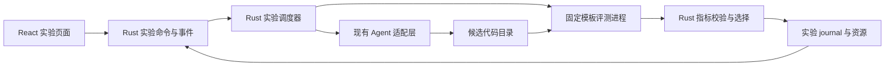

# 自动优化实验实施计划

- 创建时间：2026-10-15 22:06，America/Los_Angeles。
- 状态：**设计完成，待实施；E0–E5 均未执行**。本轮用户请求是设计与编写计划，不执行实验、不安装依赖、不启动模型调用。
- 代码基线：分支 `codex/craft-parity-rebuild`，HEAD `32e9e829596124ca4a94e775be50aa30401c8a96`，加上本轮读取时已有的未提交改动。HEAD 不能单独代表这些在途能力；开工时重新记录 diff 摘要与相关文件 hash。
- 产品依据：[现行需求](../../requirements.md)、[架构](../../architecture.md)、[新内核](../../architecture/workbench-core.md)、[SDK 运行时](../../architecture/sdk-worker.md)。验证遵循 [开发变更矩阵](../../testing.md#开发变更验证矩阵)。
- 与主线关系：这是用户提出的 Craft 固定基线之外的增量设计；不改写 [重建计划](../2026-09-30/13:17-craft-parity-rebuild.md) 的 F01–F23 状态，不扩展旧 Chat/四阶段 Task。当前重建实施入口保持不变。

## 1. 目标与借鉴范围

给 Loom 增加“自动优化实验”：用户定义可测量目标、允许修改的实现文件、固定评测和资源预算；Agent 提出并实现候选；Rust 执行验证、比较结果、选择最佳版本并持久化证据。

借鉴 autoresearch 的五个机制：先测基线、限定修改范围、固定裁判、逐轮保留或丢弃、让实验结果指导下一轮。参考 [README](https://github.com/karpathy/autoresearch#how-it-works)、[program.md](https://github.com/karpathy/autoresearch/blob/master/program.md)、[train.py](https://github.com/karpathy/autoresearch/blob/master/train.py)。上游是外部编码 Agent 驱动的训练样板，本功能不依赖其 Python 代码、GPU 或无限运行指令。

首版场景：在可信本地 Git 项目中优化一个有固定输入和正确性验证的 CPU 计算实现。先交付 Node.js 模块基准模板，输出单一耗时指标；协议保留未来 Rust benchmark、构建体积、Prompt 评测和 GPU 模板扩展空间。

用户示例：“仅修改 `src/parser.mjs`，优化固定样本的解析耗时；所有正确性用例通过，最多尝试 10 轮，最后给我最佳补丁和实验记录。”示例路径与阈值由用户配置或模板提供，不绑定 Loom 自身业务代码。

## 2. 非目标与首版约束

- 不做通用科研平台、网页资料调研、多 Agent 并行搜索、远程 GPU、定时触发或自动合并/发布。
- 不承诺任何项目都能变快；“没有可靠改善”是合法完成结果。
- 不允许通过修改测试、数据、评分脚本、依赖或时间限制取得提升。
- 不将普通聊天历史变成无限循环；每轮有独立所有权、终态和预算。
- 首版仅支持本机 macOS 的受控模板；其他平台显示不可用原因，经过真实进程回收/文件边界验收后再启用。
- 首版要求 Git HEAD 可解析且工作区干净；脏文件、暂存改动或未忽略的未跟踪文件只阻止创建快照，不替用户 stash、提交、清理或 reset。已有 Loom 脏工作区无需为本轮计划做处理。
- 首版支持允许列表内的现有普通文本文件内容变更；新增、删除、重命名、符号链接、子模块、LFS 和二进制改动暂不支持。
- 首版交付最佳 diff、补丁和报告；“应用到项目”不在本切片自动执行。后续可复用 Review/应用服务，届时须再次校验目标基线和权限。
- 本轮只增加正式计划、索引与设计概览。实现启动时把本计划确定的产品范围同步到 requirements/architecture，并保留“目标/已实现”标记。

## 3. 成功标准

1. 用户能完成配置、预检、基线、至少 3 个候选、最终复测和补丁导出；每轮能关联假设、代码版本、指标、用量及判定原因。
2. 改善、退步、相同结果、错误输出、超时、越界改动都有独立状态；失败没有数值分数，永不被选为最佳。
3. 候选运行不修改原项目内容或 Git 状态；实验期间原项目出现后续改动不影响已冻结快照，导出的补丁仍明确标注原始 base commit。
4. Agent 不能通过产品工具写裁判/证据或上调预算；被测代码另按第 7 节的可信项目边界执行，不宣称操作系统级隔离。
5. 总时间、轮数和连续失败上限由 Rust 执行；停止后不派发新操作，活动进程完成回收后才报告终态。
6. App 重启后可以查看完整历史，并在用户恢复后继续；崩溃中的阶段标记 interrupted，不自动重跑副作用，不重复选择最佳版本。
7. 最佳结果经过固定正确性检查和最终复测；无显著改善时报告“已完成，未发现可靠改善”，而非失败或捏造收益。
8. 至少一个真实 provider 的真实本地实验通过原生桌面验收；确定性模型 fixture 用于控制边界验证，不替代这项证据。

## 4. 当前状态与需要补齐的能力

以下为本轮源码盘点，不是新运行验收。

| 现有入口 | 已有基础 | 实验功能仍需实现 |
| --- | --- | --- |
| `crates/loom-core/src/{model,repository,journal,api}.rs` | Session/Turn、租约、幂等、追加日志、恢复 | Experiment/Run/Trial、独立租约与资源读取 |
| `crates/loom-core/src/repository/runtime_context.rs` | 冻结上下文、受信 cwd 绑定 | 当前 Project 会话解析到原项目；新增仅宿主可创建的实验工作目录绑定 |
| `crates/loom-runtime/src/{core_bridge,policy,supervisor}.rs` | 策略、审批、SDK 监督、进程组与截止时间 | 实验策略收窄、独立评测进程 runner、轮次与总预算 |
| `src-tauri/src/workbench/runtime.rs` | 开发宿主队列、Claude/Pi 接线 | 现有单 worker 15 分钟期限不能代替实验服务；新增受管调度入口 |
| `packages/provider-workers/src/runtime-worker.ts` | 多 provider 工具授权和用量事件 | 按实验能力裁剪工具、按候选构建有界上下文 |
| `src/workbench/` | 会话、审批、设置与投影基础 | 实验表单、状态、结果表、diff、导出 |
| `Turn.usage` / `TokenUsage` | 累计输入/输出 token 持久化 | 跨 Trial 汇总、缺失用量处理；精确金额控制未具备 |

REA 的外部工具桥仍有在途改动；本功能不依赖 REA，也不将实验包装成假 MCP Source。Sources/Skills、内容仓库及 M6 Task/Automation 还不是可直接调用的完整产品服务。

依赖安排：E0–E3 可在现有新内核上建立独立实验服务与开发入口。E4–E5 复用届时稳定的 Workbench 导航/Review；与 M6 统一任务互斥和生命周期接口。M6 尚未完成时不为实验另建第二套通用 DAG、定时器或旧 Task 流程。发行启用还依赖真实 SDK 资源打包可用，不能用开发模式成功冒充发行完成。

## 5. 产品交互

### 5.1 创建与预检

项目页增加“实验”入口，包含实验列表与“新建实验”。无 Project、无模型连接或平台能力不足时显示具体原因。

配置项：名称/目标说明、连接与模型、Node 基准模板、可改文件、固定模块接口、正确性用例和 benchmark 数据、指标改善阈值、预算。单指标默认 `elapsed_ms / minimize`；模板版本决定单位与方向，用户不能在运行中切换。

首版不暴露任意 shell 字符串评测器。模板使用用户确认的固定 Node 可执行文件和宿主生成的 argv；用户选择数据/用例文件与模块接口。其他项目先显示模板不兼容，后续再加入受控的自定义评测器注册。

Node 模板 v1 约定：ES module 导出同步 `compute(input)`，输入/返回值为有大小限制的 JSON 数据；正确性用例为冻结的 input/expected 对，按结构比较，拒绝非有限数值。只支持显式 manifest 内的本地纯计算模块，不自动安装第三方包。Node 缺失时报告不可用并给出安装说明，不静默安装。预热与正式样本使用独立于 Agent 的持久子进程，计时覆盖一批请求的 IPC 和计算，不含 Node 首次启动；启动耗时另记且仍计入执行预算。此契约让 E0 有可复现目标，后续模板另行版本化。

预检由 Rust 完成：Git 状态、文件类型/大小、工具链、离线依赖、数据 schema、模板哈希、可改路径、磁盘预算、provider 能力与预算可执行性。展示将发送给模型的文件范围、执行本地代码的授权范围、目标指标和预算。用户点击“开始实验”后一次授权冻结配置内的操作，不对每轮同范围改动重复确认；范围外操作拒绝或转 blocked，不能静默提升权限。

### 5.2 运行与结果

- 顶部：状态、当前阶段、已用轮数/时间/用量、初始基线、当前最佳、收益是否经最终复测。
- 主表：轮号、假设摘要、正确性、候选/同期最佳分数、改善率、判定、耗时。点击查看原始样本、diff、脱敏日志与失败原因。
- 操作：“暂停”在安全边界收敛；“立即停止”终止当前阶段；“继续”仅在可恢复状态可用。
- 结束：并排显示初始基线与最终复测结果，导出 UTF-8 补丁、JSON 数据和 Markdown 报告；没有改善则只导出报告。未复测结果标记“候选结果，尚未确认”，不能作为已验证最佳补丁导出。
- 调整目标、模型、允许路径、模板、数据、阈值或预算会克隆出新的 Spec revision 和 Run；原记录不可覆盖。已开始的 Run 不接受加预算或更换模型。
- 实验关联会话只读呈现过程；用户继续聊天应创建普通会话或新实验，不能向受调度候选会话注入排队消息。

## 6. 架构、领域与持久化

### 6.1 责任边界与运行方式

首版不新增 crate，分别在 `loom-core` 和 `loom-runtime` 内新增 `experiments/` 子模块；Tauri 仅提供宿主生命周期和用户意图桥接。React 不执行命令、不直接读文件、不计算权威判定。

一个 Run 串行处理一个 Trial。每个 Trial 创建专属关联 Session/Turn，仅有一个候选生成回合；关联 ID 存在实验域，不要求已完成通用子会话服务。跨 journal 采用持久化阶段意图与确定性 operation ID 对账：恢复可查询已创建 Session/Turn，但不能重新调用模型。Trial 完成后上下文只保留基线、当前最佳和受限历史摘要，避免持续膨胀。

复用 `TurnLease` 管理一次模型调用；新增 `ExperimentLease` 管理整次实验，绑定 workspace/project/run/generation。所有结果写入要求有效租约与 Trial/operation ID；终态、重复帧和旧代结果不能改变最佳指针。

新增宿主专用工作目录绑定：根据 run/trial ID 解析受管目录，校验实际目录身份并绑定 snapshot digest；前端不得传绝对 cwd。实验 Session 禁止普通 `SendMessage` 调度；实验调度器通过受信入口创建与领取回合，仍使用原有冻结连接、策略和审批链。不能仅把 `RuntimeBinding.workingDirectory` 改成用户传入字符串。

### 6.2 核心模型（目标契约）

| 模型 | 必需字段/不变量 |
| --- | --- |
| ExperimentSpec | id/revision、workspace/project、goal、baseCommit、允许的相对文件路径、templateId/version/digest、数据/正确性用例 digest、metric/direction/unit、阈值、BudgetSpec、connection/model 快照、policy digest |
| ExperimentRun | id/specRevision、status/phase、generation、baselineSnapshotId、incumbentTrialId、finalVerifiedTrialId、terminationReason、计数/用量/活跃时间、environmentFingerprint、created/started/ended 时间 |
| Trial | id/index、parentSnapshotId、hypothesis、session/turnId、candidateSnapshotId、phase/status、correctness、samples/score、incumbentScore、decision/reason、日志/差异资源 ID、实际耗时和用量 |
| EvaluationRecord | operationId、run/trial/generation、模板/数据/候选/环境 digest、sampleBatchId、样本数量、单位、exitStatus、correctness、结果文件 digest |
| ExperimentResource | id、所属 Run/Trial、类型、SHA-256、字节数、受管路径映射；通过 ID 读取并限制分页/大小 |
| ExperimentAuthorization | Run/Spec/source/template/policy digest、允许的工具与文件、评测命令身份、预算、授权代次；仅宿主签发和消费，不能跨 Run 继承 |

失败或未运行的 score 为 `null`，附 reason；不能用 0、NaN 或正负无穷充当失败指标。首版最佳值是同一 Spec/环境中的比较结果，不能跨设备或模板汇总排行榜。

用户命令：create/update_draft/preflight/start/list/get/pause/resume/stop/read_events/read_resource/export。所有变更带 operationId 和 expectedRevision；重复相同操作返回原结果，冲突返回明确错误。publish_candidate/evaluate/select_best 属于宿主方法，不暴露为用户可写 IPC。Rust 生成 TS 协议并检查漂移。

### 6.3 存储与提交顺序

目标布局：`<data-root>/workspaces/<workspaceId>/experiments/<runId>/`，包含 `events.jsonl`、`commit.json`、可重建的 `summary.json`、冻结 `spec.json`、`snapshots/`、`resources/` 和可清理 `staging/`。沿用现有 journal 的 checksum/seq/writer 锁机制；新增实验资源读写服务不冒充 M5 通用内容仓库。

顺序：先保存阶段意图 → 执行有唯一 operationId 的操作 → 写临时资源并同步 → 原子发布不可变资源 → 在同一实验事件中记录 Trial 判定与最佳指针更新 → 发布通知。文件已发布但事件未落盘时为孤立资源，只能核验后对账或清理；事件不得引用未完整发布资源。

创建关联 Session/Turn、准备快照和评测操作均需故障注入覆盖“请求发出/结果持久化”的间隙。恢复不假设多个 journal 原子提交；无法判定外部操作是否完成时保留 interrupted，由用户重新运行新 Trial。

## 7. 快照、权限与评测信任

### 7.1 保留原项目

首版只从经预检的 Git tree 读取模板 manifest 明确选择的跟踪普通文件，生成独立、按内容校验的快照；不执行 checkout/filter/hook，不复制 `.git`、ignored 文件或原目录中的运行产物。将可改实现、只读依赖、模型上下文和评测数据分组列给用户确认，默认排除 `.env`、私钥和认证配置路径；不声称可以识别任意源码中隐藏的秘密。模板为纯 Node 模块，不能隐式复制整个 `node_modules`；依赖不满足即预检失败。

候选目录是快照副本，不含 Git 元数据；Agent 只看到允许的输入文件和裁剪后的上下文。每轮从当前最佳快照派生，生成完毕停止 Agent 后计算差异、验证允许路径与文件类型，再发布不可变候选快照。坏候选直接丢弃运行资格；报告保留差异证据，不在原项目执行 Git 回退。

重复候选按完整快照 digest 检出，记 discarded/duplicate 并消耗候选轮数，避免无限无效搜索。主目录在实验期间可以继续变化；导出补丁绑定原始 baseCommit，提示用户自行审阅和解决基线冲突。

### 7.2 Agent 与被测代码分开约束

Agent 仅开放当前适配器可验证的 read/glob/grep 和 write/edit；禁止 Bash、任意进程、网络工具、MCP Source、动态依赖安装和用户自动加载的扩展。读取只在上下文快照内，写入只在候选允许文件内；默认拒绝 symlink/硬链接别名与路径逃逸。无法证明工具收窄与真实拒绝的 provider 不可用于实验，普通聊天能力仍保留。

模板/数据/正确性 oracle 与证据目录不进入可写候选路径。宿主以冻结 manifest 装配评测树，并由受信 runner 发布指标结果；候选 stdout/stderr 只作日志，出现 `score: 0` 等文本不影响评分。

**评测进程执行的是项目代码**。只读目录约定、hash、worktree 或进程组都不是 OS 沙箱；同用户恶意代码仍可能读写外部文件或影响测量。首版明确限定可信项目和可审阅候选，不能宣称抵御恶意候选、全面网络隔离或数学意义的防作弊。E0 必须验证模型工具边界、裁判篡改检测、结果协议和进程回收，并记录残余风险。若产品要求运行不可信代码，需增加独立 OS 隔离里程碑，完成前不可开启该能力。

评测子进程使用独立临时 HOME/工作目录与最小环境，不传模型凭据或用户配置；模型调用凭据仍仅走既有私有管道。固定执行文件与模板资源由 Rust 解析；用户编辑模板、输入数据或授权范围后必须生成新 Spec 并重新预检。

Node 首版模板由受信控制进程持有用例和计时/正确性判定，候选模块在子进程中按固定输入输出协议运行，单请求有超时和输出上限。以宿主可观察的端到端耗时作为指标，明确包括进程通信成本；子进程报告的内部计时不作为真值。不得为了减少测量开销把任意候选加载到 Loom 主进程。

### 7.3 资源与授权

“开始”绑定 Spec、源快照、工具链、策略与数据 digest；每个调度操作再次核对租约和资源归属。原有策略拒绝优先，实验授权不能提升权限模式；Explore 不可启动变更实验。Ask 只在已确认的精确实验范围内执行，越界不以重问或提示词绕过。

评测、基线、重试和复测均纳入总预算；输出超过上限记录 log_limit 并停止对应进程。秘密脱敏后保存日志，原始模型凭据、认证配置和环境全文不写入资源。

## 8. 评分与预算

### 8.1 固定比较规则

1. 先跑基线正确性，再测基线性能；失败即 blocked，不让 Agent 修改裁判“修好基线”。
2. Node 模板每批预热 1 次、正式采样 5 次，取中位数；样本/重复次数/数据在 Spec 中冻结。E0 应测量固定输入的耗时，若单次过短，则在模板校准阶段增加固定批量大小，校准结果在启动前冻结。
3. 每轮正确性通过后，将候选与当前最佳在同一环境交替测量，各获得 5 个正式样本。以配对差值的中位数判断改善，报告同时保留两组原始样本；不拿昨晚的旧分数直接比较现在的结果。
4. 对耗时指标，改善量 `D = median(incumbent_i - candidate_i)`；仅当 `D > max(absThreshold, relativeThreshold * median(incumbent_i))` 且正确性通过才选为 kept。默认相对阈值建议 1%，绝对阈值由 E0 模板校准确定，作为配置展示；这些是待验证默认值，不是性能保证。
5. 耗时样本必须为有限正数；样本噪声用 `MAD / median` 检查，初始建议阈值 5%。任一组超限时允许整批重测 1 次；仍不稳定记 inconclusive，不能晋升。连续 2 轮 inconclusive 进入 blocked/environment_unstable。统计规则是产品启发式，不对外宣称显著性置信水平。
6. 相同/退步、重复候选或低于阈值的改善记 discarded；错误、超时、缺失/非有限/单位不符结果记 failed。硬正确性门禁优先于性能收益。
7. 正常搜索结束进入 finalizing，以固定的独立留出用例检查当前最佳，再与初始基线做同期复测。通过才发布 finalVerifiedTrialId 和可导出最佳补丁；失败或预算不足保留候选证据，结果标为 unverified，不报告已验证改善。

环境指纹记录 OS/架构、CPU、工具链与模板版本、依赖/数据 digest、测量参数。恢复或运行期间关键指纹改变则 blocked/environment_changed，需新 Run 建立基线；温度/系统负载不可完全控制，依赖同期比较与噪声门禁。首版本机同一时刻只允许一个实验执行，普通 Chat 可继续但 UI 提示其可能干扰基准；不得擅自终止用户进程。

### 8.2 默认预算（E0 校准后可调整；启动后冻结）

| 项目 | 初始建议 | 执行语义 |
| --- | --- | --- |
| 候选轮数 | 10 | 准备开始生成即占用；重复、失败、用户恢复后的新尝试也计数；基线/最终复测不占候选数 |
| 总活跃时长 | 60 分钟 | Rust 单调时钟累积，覆盖生成/构建/评测/等待审批/回收；暂停后的静止时间不计 |
| 单候选完整期限 | 10 分钟 | 包括生成与全部评测/重测；子操作 deadline 不得晚于此值或总剩余期限 |
| 单次 Agent 生成 | 3 分钟 | 复用 supervisor，按更早期限终止；不继承普通回合 15 分钟默认值 |
| 单次评测批次 | 2 分钟 | 含启动、预热、采样与回收；模板内每请求期限更小 |
| 最终复测预留 | 5 分钟 | 剩余预算低于预留时不再生成，转 finalizing；复测仍受总期限限制 |
| 连续失败 / 无改善 | 3 / 5 轮 | 失败触发 blocked；有效但无改善触发 finalizing；kept 清零两类计数 |
| 日志 / Run 资源 | 每操作 10 MiB / 每 Run 1 GiB | 有界写入；资源不足停止并留摘要，不静默删除已验证最佳证据 |

暂停意图发生后，活动阶段仍计时直到进程与资源写入已收敛。崩溃恢复只能从持久化预算继续；崩溃中阶段按预留的最大执行预算保守扣除，防止重启免费重跑。墙钟时间用于展示，不用于运行时放宽期限。

Run 和 Trial 均保存累计活跃时间；暂停后恢复按剩余量重建 deadline，不能继续使用已过期的旧 Instant，也不能重置已消费时长。到期触发取消，另有最多 3 秒 SIGTERM 宽限后强制回收；UI 分开显示执行超时与回收耗时。无法确认清理完成时保持 stopping/blocked，不伪报进程已停止。

token 上限是可选的累计观测阈值：按已持久化用量在派发前拒绝新请求，运行中收到用量后超限则取消。provider 延迟报告会产生超调，必须展示“非账单硬上限”；不支持可靠用量的 provider 不得接受此预算模式。精确金额预算与 provider 请求级预留机制不进入首版。UI 不把时长/轮数预算展示成“最多花费 X 元”。

## 9. 状态机、暂停与恢复

Run 状态：`draft → preflighting → ready → running → finalizing → completed`。额外状态为 `pausing / paused / stopping / cancelled / blocked / interrupted / failed`。phase 记录 snapshot、baseline、proposing、validating、measuring、selecting、final_check。

| 操作/事件 | 确定行为 |
| --- | --- |
| 暂停 | 进入 pausing，禁止新阶段；已启动的有界阶段结束并落盘后 paused。Agent 生成阶段完成可保留候选，下次恢复先核验再进入评测。等待审批时撤销待决请求并取消该生成，避免无期限暂停。用户可改按立即停止。 |
| 立即停止 / 总预算耗尽 | 先持久化停止意图，再取消 Agent/评测进程并回收，记录部分证据；用户停止为 cancelled，预算耗尽为 completed/budget_exhausted，但 verification 可能为 unverified。 |
| 达到轮数 / 无改善阈值 | 如果可复测则 finalizing；否则 completed 且明确未完成最终验证。结束原因与结果验证状态分开。 |
| 基线错误 / 连续失败 / 环境异常 | blocked，说明可恢复原因；不自动安装依赖或修改配置。基础设施/日志完整性错误为 failed，禁止继续写入可疑 journal。 |
| App 正常退出 | 停止调度，回收进程并持久化 interrupted/app_exit；下次启动只恢复视图，不自动执行。 |
| 崩溃后启动 | 丢弃旧租约代次；对账已发布资源/关联 Turn，未完成 Trial 标为 interrupted。确认旧进程已收敛后才能恢复，不能仅凭旧 PID 杀进程。 |
| 恢复 | 重新核验资源、能力、策略和环境；保留累计预算。安全边界 paused 可继续下一未启动阶段；崩溃/强制中断的 Trial 不重放，在剩余轮数内建新 Trial。 |
| 晚到结果 / 审批 | 停止意图和租约代次优先；旧结果可以作为诊断，不更新候选或最佳指针。 |

SDK runner 与评测 runner 统一参加宿主 shutdown barrier。必须复用/抽取进程组生命周期，而不是调用 SDK JSONL 协议启动普通评测脚本。E0/E2 验证父进程异常退出后的 orphan 处理：增加独立 watchdog/父管道关闭检测及身份核验；无法确认旧进程退出时保持 blocked，不能先启动第二份实验。

completed 表示这次预算内的实验结束；`resultVerification = verified / no_improvement / unverified` 决定是否可宣称收益。cancelled、blocked、interrupted 保留上次已确认候选，但不伪造本次最终验证。

## 10. 里程碑与交付顺序

所有状态初始为 `not-started`。每阶段完成后在本计划追加命令、实际结果、证据路径及限制，并同步 PLANS 摘要。

### E0 — 固定模板与边界验证

依赖：现有 core/runtime 可构建；使用临时合成项目，不修改用户项目。

任务：

1. 实现最小 Node 模板探针：固定输入/输出契约、宿主计时与正确性 oracle；准备可验证的快/慢/错误/超时/伪造输出 fixture。
2. 测量模板开销、重复样本与噪声，确定绝对阈值、批量大小和预算默认值；记录 Node/OS/CPU/数据版本。
3. 检查真实 provider 是否可关闭 Bash/MCP/自动扩展并限制读写目录，验证拒绝写裁判和原项目；不以静态工具清单代替验证。
4. 验证评测进程组取消、父进程崩溃与 orphan 对账；列明被测任意代码的残余边界。
5. 固化本计划产品范围至 requirements，新增实验架构契约；记录不可用 provider/平台，不自动扩大实现目标。

产物：`tests/fixtures/experiments/`、模板 schema/probe、`docs/dogfood/experiments/e0-*.{md,json}`。这些路径为拟新增。

出口：固定模板能识别真实改善、错误和伪造 stdout；安全边界与停止机制有真实进程证据。无可用 provider 则 E3 真实接线 blocked，E1/E2 可继续；隔离与测量不可信时不开放无人值守入口。

### E1 — 实验领域、journal 与 IPC 契约

依赖：E0 固定 Spec、结果 schema 和状态定义。

任务：

1. 新增 `crates/loom-core/src/experiments/{model,repository,state,api}.rs`，实现 Spec/Run/Trial、租约、幂等、冻结实验授权、预算账本与最佳指针事务。
2. 接入独立实验 journal、资源 manifest、分页查询与 workspace 归属；对损坏/磁盘满/重复事件/旧 revision/跨 Run 写入做生产路径测试。
3. 新增宿主专用受管 cwd 与实验 Session 所有权，拒绝 renderer 自定 cwd 和向实验 Session 普通发送。
4. 更新 Rust 生成 bindings，不手写协议；验证旧会话/无实验工作区无需迁移仍可读取。

产物：真实 Core API、生成协议、状态/恢复测试、契约文档。

出口：不调用模型即可用真实存储回放完整实验；阶段意图和跨 journal 对账不重复创建副作用。

### E2 — 快照、评测 runner 与评分

依赖：E0 模板及进程方案、E1 状态和资源模型。

任务：

1. 新增 `crates/loom-runtime/src/experiments/{snapshot,evaluator,judge,budget}.rs`，实现 Git tree 快照、允许路径校验、候选冻结和重复检测。
2. 从现有 supervisor 提取或复用进程生命周期原语，SDK 协议保持原有行为；新增普通命令 stdout/stderr 有界采集、取消、deadline 与孤儿检测。
3. 通过受信 Node 模板运行基线、正确性、交替采样和最终复测，校验所有身份/digest/样本/单位/退出条件；host 输出正式 EvaluationRecord。
4. 实现收益阈值、噪声重测、失败分类、资源预算和部分日志；禁止失败分数晋升。

产物：可运行的 headless 实验 harness、快/慢/失败 fixture 证据、原项目前后内容与 Git 状态对比。

出口：无需模型即可覆盖 kept/discarded/failed/inconclusive，超时和取消回收全部受管子进程，原项目保持不变。

### E3 — Agent 串行循环与生命周期

依赖：E1/E2；至少一个通过 E0 能力验证的 provider。

任务：

1. 新增 `crates/loom-runtime/src/experiments/{scheduler,context,policy}.rs`，驱动“当前最佳 → 单轮假设/改动 → 冻结 → 评测 → 判定”；从结构化输出获取假设，不接受模型声明的分数或完成状态。
2. 通过现有 `run_session` 调用，每个 Trial 独立 Turn 与受管 cwd；生成新的明确模型上下文，包含上一轮失败和受限历史，固定连接/策略。
3. 实现 budget 预检、暂停/停止/恢复、连续失败与无改善停止；每次派发前重查租约/停止信号。
4. 在 `src-tauri/src/workbench/experiments.rs` 接入 app shutdown、单实验执行槽和事件订阅。停止信号应按 Run 独立，不用全局 app stop 取消单个实验。
5. 用确定性模型 fixture 覆盖可靠选择，再用真实 provider 在隔离样例跑至少 3 轮；真实未改善也如实记录，不要求模型碰巧取得特定分数。

产物：生产循环、关联会话记录、headless 真实执行日志、停止/重启恢复证据。

出口：结束条件全部由 Rust 控制；重启和迟到结果不能重复执行或改变最佳记录；无工具放权旁路。

### E4 — Workbench 交互与导出

依赖：E3 查询/订阅接口；现有 Workbench 导航和权限卡片可用。

任务：

1. 新增 `src/workbench/experiments/`，实现列表、配置/预检、运行详情、结果表、日志/diff、空态/不可用/失败/恢复态；设计资源保存在 `designs/experiments/`。
2. UI 操作只发用户意图，依据宿主状态和 revision 展示，不用前端计时器推进阶段或推导最佳分数。
3. 导出内容只读受验证资源，补丁覆盖原始基线至最终最佳的累计差异；包含版本/数据/环境/判定/限制，排除凭据与非允许路径。
4. 完成暂停与立即停止语义、预算超调说明、未最终验证结果标识；支持键盘操作和非颜色状态区分。

产物：原生桌面流程、相关前端回归、导出 fixture、截图与验收记录。

出口：用户不依赖终端完成创建至导出；切会话、刷新与重启不丢历史或串实验。

### E5 — 故障验收与首版交付

依赖：E0–E4，真实 provider、模板工具链和运行所需资源可用。

任务：执行第 11 节矩阵，回填真实结果；检查与普通 Chat、REA、宿主退出和 M6 任务的资源互斥边界；完成文档、功能开关与只读回退验证。

开发入口可通过宿主 capability 启用；正式发行入口仅在 SDK/模板资源定位和打包验证完成后启用。不为绕过主线缺口把入口接回旧 Chat。完整门禁、原生桌面验证和真实模型证据缺一项均不标为交付完成。

产物：`docs/dogfood/experiments/acceptance.md` 及机器可读结果、更新的需求/架构/计划状态、发布限制。

出口：成功标准逐项有证据，文档明确当前支持 macOS/Node 模板及可信项目边界；其他平台/模板仍不可用。

## 11. 验证策略

### 11.1 必须覆盖的行为

| 类别 | 用例与预期 |
| --- | --- |
| 正常循环 | 固定基线、快/慢候选、最终复测；正确选择改善，补丁可在基线副本重现相同正确性 |
| 无改善 | 相同分数、重复代码、低于阈值；正常结束并明确无可靠改善 |
| 判分失败 | 错误输出、非零退出、缺失/重复/NaN/无穷指标、单位/digest 不符、stderr 伪造；不晋升 |
| 波动与漂移 | 预热影响、注入噪声、模板/数据/工具链变化；重测有界或 blocked |
| 权限 | 原项目写、裁判写、路径穿越、symlink/硬链接、越界读、Bash/MCP、扩大预算；生产工具入口拒绝 |
| 预算 | 0/负数/溢出配置、轮数用尽、连续失败、无改善、时间到期、日志/磁盘超限、延迟 token；状态与账本一致 |
| 并发与恢复 | 连点 start、跨窗口、重复事件、旧租约、取消后成功、已发未记、资源已写事件未写、损坏 journal；不重复执行/晋升 |
| 进程 | Agent/评测分别超时、忽略 SIGTERM、孙进程、父崩溃、App 退出；回收可验证，无法确认则 blocked |
| 暂停/停止 | 各 phase 暂停与立即停止、审批等待、恢复剩余预算；不新派发越过停止意图 |
| 项目保护 | 脏树预检拒绝；实验期间源项目新增改动；原内容/index/refs 前后无实验写入，补丁指向原 baseCommit |
| UI/资源 | 切换会话、离线查看、长日志、分页、缺资源、重启、无 provider/Node、未验证导出；无假成功 |

运行中候选脚本恶意逃出同用户目录是已声明边界：不以工具拒绝测试作为 OS sandbox 证明。E0 报告必须将“宿主工具层阻止”与“执行任意项目代码未隔离”分开。

### 11.2 检查命令与证据

- E1–E3：相关 Rust 测试与 `pnpm check:core`；若修改 provider worker，再运行其 TypeScript 类型检查与真实 hook 拒绝/允许验证。
- Tauri 接线：相关 `cargo test --manifest-path src-tauri/Cargo.toml <filter>`、适用 fmt/clippy，以及生产 IPC/取消/退出测试。
- E4：`pnpm test -- tests/unit/<实验相关文件>.test.cjs`、`pnpm build`；原生流程启动前执行 `scripts/debug.sh stop`，使用 `scripts/debug.sh desktop`，结束后再次 stop。
- E5：`pnpm check`、`pnpm tauri build --no-bundle` 和实际 macOS 桌面验收；有新失败或未解决风险才扩大/重复测试。发布分发另按 [发布入口](../../release/README.md) 执行。
- 每条证据含 app commit+工作区摘要、模板/provider/工具链/OS 版本、Spec/数据/候选 digest、run/trial/operation ID、命令/cwd/耗时/退出原因。模型调用成本真实记录；无凭据记 blocked，未运行记 not-tested。

本轮仅文档：校验相对链接、Markdown、索引日期/时间倒序、已有索引内容保留、需求与当前状态一致性和 `git diff --check`；不运行应用测试。

## 12. 风险、回退与后续扩展

| 风险 | 应对与验收依据 |
| --- | --- |
| 模型优化了评测而非真实效果 | 固定模板、独立正确性/留出用例、原始样本和最终复测；诚实说明不保证防恶意作弊 |
| 固定数据过拟合 | 使用单独留出集；导出说明只对当前任务/环境有效 |
| 候选运行有副作用 | 首版可信项目与范围授权，最小环境，无模型凭据；不支持不可信仓库 |
| 计时噪声或热降频 | 同期交替采样、噪声重测门禁、单实验槽；不承诺固定提升 |
| 资源与用量失控 | deadline/轮数硬约束，日志/磁盘限额；token 观测阈值不伪装货币上限 |
| 与主线重建相互干扰 | 独立模块和 capability，保留旧功能回归；与 M6 共享生命周期入口，避免第二套调度平台 |
| 未提交在途代码变化 | 开工重盘点相关接口/摘要；不覆盖 REA、更新功能及已有文档变更 |

回退：关闭实验 capability 后停止接收新运行，现存进程有界回收；实验历史仍可只读打开/导出，不删除原项目或实验证据。不把实验 schema 写入旧 Chat/Task 数据。资源清理只有显式用户操作，先停止所属 Run 并校验目录归属，不使用宽泛递归清理。

后续顺序：先增加兼容固定评测契约的 Rust/构建体积模板，再评估 Prompt/RAG 和 GPU runner。自动应用、远程执行、OS 沙箱、货币硬预算、多 Agent 并行和定时触发各自单独设计与验收，不由首版接口预留推定已支持。

## 13. 待确认问题与实施记录

产品方向无阻塞问题。首版按“macOS、可信本地项目、Node CPU 模板、单 Agent、单指标、串行、导出补丁”推进设计。模板计时开销、适配器工具限制和孤儿进程处理属于 E0 工程验证事项，无需用户替工程实现猜测。

本轮完成：正式计划与索引；配套概览见 [设计说明](../../../designs/experiments/implementation-overview.html)。未修改生产代码、启动预览、执行 benchmark、调用模型或宣称任何里程碑通过。

本轮文档验证：计划必需章节、6 个里程碑、Markdown 围栏/表格/尾随空白、8 个本地链接及锚点、索引 30 个文件存在性与日期/同日时间倒序均通过；`git diff --check` 通过。概览 HTML 生成成功，文本检查 0 warnings；未运行桌面视觉验收。E0–E5 实施证据：暂无。
