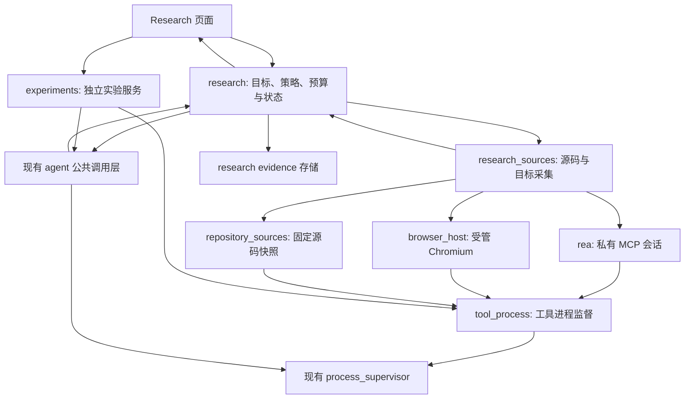

# Research 多目标研究与自动实验实施计划

- 创建时间：2026-10-28 04:41，America/Los_Angeles。
- 修订时间：2026-10-28 05:46，America/Los_Angeles；补齐开工审查的四项契约，复审记录见 §14。
- 状态：**实施中：R0–R2 后端阶段通过；R3–R7、E0–E2 待实施，尚未整体验收**。用户已授权按计划实施。R0 在隔离临时目录准备了固定 REA／兼容 Node，系统工具和全局 MCP 配置未改；证据见 [R0 验收](../../dogfood/2026-10-28-research-targets-r0.md)。原计划阶段的“仅文档”范围已由本次实施授权更新。
- 代码基线：`main`，HEAD `8e56fbdfc3d101348884c091ee0aad3d876681a7`，加上当前工作区已有改动。当前存在 Agent 生命周期、Discuss、WebView 恢复等未提交内容，不能用 HEAD 单独代表本计划读取到的能力；实施前重新核对状态，保留用户改动。
- 用户目标：Research 除 GitHub／源码之外，可以输入网站或选择 App，以 REA 研究其实现与行为；借鉴 autoresearch 的假设、验证、记录和迭代机制。
- 当前依据：[需求](../../requirements.md)、[架构](../../architecture.md)、[Agent 层](../../architecture/agent-layer.md)、[Research 契约](../../architecture/research-contracts.md)、[安全策略](../../security-policy.md)、[验证矩阵](../../testing.md#开发变更验证矩阵)。以下新增能力均为目标，不代表已实现。
- 后续本方向实施以本计划为入口；不恢复冻结 Workbench、新内核、SDK worker 或旧 Task。历史 [REA 计划](../2026-10-15/10:51-rea-research-module.md) 与 [自动优化计划](../2026-10-15/22:06-auto-optimization-experiments.md) 只作为参考。

## 1. 目标、交付线与非目标

### 1.1 两条交付线

**A：证据研究，R0–R7。** 保留现有问题式 Research，增加 GitHub、网站、本地 App 三类显式目标。Rust 采集并保存证据，用户选择的 CLI Agent 分析证据、生成报告及提出下一步验证。支持一次研究和有预算的连续调研。

**B：自动优化实验，E0–E2。** 在 Research 内提供独立“优化实验”模式，但使用独立领域、执行策略和存储。用户选择自己的可信本地项目、固定评测与修改范围；Agent 提出候选，宿主验证并保留或丢弃。交付最佳补丁和完整实验记录，不自动应用到原项目。

REA 是工具提供者，不是模型或 Agent Adapter。autoresearch 是方法参考，不引入其训练代码或 GPU 依赖。A 可独立交付，B 的失败或延期不阻止 A 上线。

### 1.2 首版支持范围

| 输入 | 首版行为 | 明确限制 |
|---|---|---|
| 普通问题／已登记本地项目 | 保留当前 Research 与追问行为 | 既有 CLI 权限限制不变 |
| 公开 GitHub 仓库 URL | 拉取固定 commit，提供源码证据与问题报告 | 沿用 Learn 的公开 HTTPS 范围，不运行仓库代码 |
| 网站 URL | Loom 启动独立 Chromium 配置，REA 被动观察页面、脚本与网络元数据，可请求截图 | 首版不自动点击、输入、提交、登录；页面加载会执行网站脚本并联网 |
| 本地 App | 文件选择器选择 `.app`／安装目录／ASAR／本地 JS 产物；先识别再静态分析 | 首版优先 Electron／JavaScript；原生引擎仅做诊断，深度分析后续开放 |
| 仅 App 名称或商店链接 | 引导用户选择实际本地路径或改用网站目标 | 不猜测目标、不自动下载安装包、不把商店介绍当实现证据 |

单个研究首版只有一个根目标，可含该目标产生的多个证据；不做多产品批量对比。Learn 保持源码 Wiki 定位，Research 提供围绕问题的调查；共享底层获取能力，不合并两套历史数据。

### 1.3 非目标

- 不建立通用 MCP／Sources 平台，不改变用户级 Claude、Codex 或其他 CLI 的 MCP 配置，不自动执行 `rea setup`。
- 不在本计划中交付 App 启动／注入、设备控制、主动浏览器脚本、账号操作、付费提交、自动登录或服务器扫描。
- 不恢复多 Agent 编排、DAG、远程 GPU、定时任务、自动合并或发布。
- 不宣称闭源应用能完整还原源码；静态候选、观察到的行为和推测必须区分。
- 不改变 Chat／Learn／Discuss 业务语义，不触碰旧 Task 数据；不将本机同用户运行描述成 OS 沙箱。

## 2. 当前实现与已知差异

| 已核实能力 | 代码位置 | 本次扩展需要补齐 |
|---|---|---|
| Research 输入问题、Agent／模型与可选项目 | [NewResearchForm](../../../src/features/research/NewResearchForm.tsx)、[models](../../../src-tauri/src/research/models.rs) | 显式目标、执行模式、预检结果和预算 |
| 首问、原生续聊／历史回放、停止与重试 | [jobs](../../../src-tauri/src/research/jobs.rs)、[commands](../../../src-tauri/src/research/commands.rs) | 多步骤研究、计划校验、阶段恢复与总预算 |
| Markdown 报告和源码引用 | [prompt](../../../src-tauri/src/research/prompt.rs)、[source_files](../../../src-tauri/src/source_files.rs) | Evidence、截图、目标指纹、覆盖率与未知项 |
| GitHub 导入位于 Learn | [fetch](../../../src-tauri/src/learn/fetch.rs)、[NewStudyForm](../../../src/features/learn/NewStudyForm.tsx) | 抽取共享获取服务；Research 不导入 Learn |
| Agent CLI 统一调用与进程生命周期 | [agent/mod.rs](../../../src-tauri/src/agent/mod.rs)、[生命周期](../../../src-tauri/src/agent/lifecycle.rs) | 新增独立工具进程通道，不用 Agent 流解析器解析 REA JSON-RPC |
| 冻结 REA MCP 客户端、固定 6.5.0 catalog | [rea.rs](../../../crates/loom-runtime/src/rea.rs) | 按当前桌面架构选择性移植、重新验证；不得直接依赖冻结 crate |

旧桥仅向 worker 暴露 `binary_session`、`get_evidence_bundle`、`inspect_analysis_view`、`list_unknowns`、`verify_unknown_resolution`。这不是 App／网站采集链，不能靠启用旧开关完成本计划。

已知文档偏差及处理：

1. 旧计划索引称 REA 已接“生产权限策略”，但 [根 Cargo.toml](../../../Cargo.toml) 标记实验内核冻结，[桌面入口](../../../src-tauri/src/lib.rs) 未挂载 Workbench。本轮将索引明确为冻结历史实现，不计为当前 Research 能力。
2. 旧 REA 计划的验证命令引用 `tests/unit/reaMcpContract.test.cjs`，实际位于 [tests/frozen-workbench/reaMcpContract.test.cjs](../../../tests/frozen-workbench/reaMcpContract.test.cjs)。本轮补充当前路径说明，保留历史执行记录。

上一轮审查证据：Research 前端定向测试 4/4、冻结 REA fixture 测试 4/4 通过；后者只证明保存的 6.5.0 契约。未运行真实 REA、浏览器或 App 调研。此前 2026-10-15 的 R0/R1 验收属于历史版本，不作为新实现通过的证明。

基线文件 SHA-256，供实施时辨别在途改动：

| 文件 | SHA-256 |
|---|---|
| `src-tauri/src/research/jobs.rs` | `31ca8c4b783e285b5422b5ae641db52d917cf8ef1f71b933def7c5757917549d` |
| `src-tauri/src/research/models.rs` | `ace122eb10a9d1eb29454849cb0e47d25b710a8dd40121480b2650ce15fcc6d5` |
| `src-tauri/src/agent/mod.rs` | `102f98e552bb2423716b45381e77eeb42c52ec3263f74ae545f4be27c4e0dcaf` |
| `scripts/check-layers.mjs` | `8f202891f7b967abd09e8982c6b09d2b758692d674d98c759ff3ae631f373e88` |

## 3. 用户流程

### 3.1 创建与预检

Research 新建页增加“普通问答／目标研究／优化实验”。目标研究选择 GitHub、网站或本地 App，填写目标和问题，再选 Agent、模型、语言及“一次研究／连续调研”。优化实验到 E2 才显示可执行入口。

Rust 预检返回：规范化目标、可用采集能力、工具版本、缺失依赖、目标范围、预计操作、可执行预算及会发给模型的材料类别。预检不启动目标、不调用模型、不自动安装依赖。网站预检显示“将联网并加载网页脚本”，不能只标“只读”。

点击开始时冻结 `RunSpec` 和用户选择的权限范围。同范围内的采集与下一轮不重复确认；目标、权限或预算扩大时创建新 revision，由显式用户操作启动。模型输出不能自行增加授权。

### 3.2 运行与结果

- 页面显示阶段、已用轮数／时长／工具调用数、证据列表、待验证假设与停止原因。实时进度采样展示，原始输出有界落盘，不逐行刷 UI。
- 报告包含结论、已观察事实、推断、相反证据、覆盖限制、未解决问题。每个关键结论关联证据或明确标为无证据推断。
- 源码继续使用 `loom-src:`；新目标报告通过 reportId 绑定不可变源码快照，不按研究的最新 workspace 解析。新证据使用 `loom-evidence:<evidenceId>`，由当前研究／报告上下文解析。外部来源仍用 `http(s)`。
- 证据查看器展示来源、采集时间、工具版本、coverage、limitations、unknowns、脱敏摘要与本地图片。长内容分页，不执行目标 HTML／JS，不直接渲染任意 SVG。
- 追问默认只用已保存证据；需要新采集时明确显示“继续调研”。目标变化时生成新 capture，不覆盖旧证据，不把旧报告当成最新状态。
- 停止后保留已完成证据与报告；只有进程回收／状态对账完成才报告已停止。重启可查看历史，未完成运行标中断，不自动重放副作用。
- 导出 Markdown 报告、脱敏证据清单及选定附件；完整证据包单独显式选择，提示内容仍可能包含目标数据。

## 4. 架构与模块边界



以下为模块实施约定；截至本轮部分目录和后端文件已接入，完整状态以文首与 §9 为准：

| 路径 | 职责 |
|---|---|
| `src-tauri/src/research/{targets,orchestrator,policy,evidence,budget}.rs` | 类型化目标、调研步骤、宿主准入、证据存储与预算 |
| `src-tauri/src/research_sources/` | 按目标路由采集、归一化结果；不导入 Research UI 或业务仓储 |
| `src-tauri/src/rea/` | 包与运行时诊断、MCP 协议、catalog、证据封装；不决定业务授权 |
| `src-tauri/src/tool_process/` | 非 Agent 工具的 argv、管道、超时、取消与归属登记；共用现有 supervisor |
| `src-tauri/src/browser_host/` | 浏览器专用 profile、端口、目标绑定、关闭与残留诊断 |
| `src-tauri/src/repository_sources/` | 从 Learn 抽取固定 commit 获取及校验；显式接收调用方 owner，去除 study 专属归属 |
| `src-tauri/src/experiments/` | 独立实验计划、候选、评测、判定与存储；不调用 research 业务命令 |
| `src/features/research/` | 目标表单、运行阶段、证据、报告和实验入口；设计资源放 `.designs/research/` |
| `src/components/`、`src/api/` | 通用证据查看组件、typed IPC；共享层不反向导入功能 |

所有模型调用继续通过 `agent::prepare_invocation` 与 `agent::run`。REA／浏览器／评测器不是 Agent，不套用 CLI 文本流解析；新增工具通道只包装当前 supervisor，不创建第二套全局进程注册表。

分层检查同步扩展：新增共享模块不得反向导入 Chat／Learn／Research／Discuss／Experiments；功能模块不得直接 spawn；仅具名工具通道允许进程调用。抽取 Learn fetch 时移除旧位置的 spawn 例外。为别名导入与新增模块添加违规 fixture，不能靠移出扫描目录绕过门禁。

### 4.1 REA 接入方式

1. R0 用固定版本 CLI 做独立探针；生产 R2 使用直接启动的 `rea mcp`，一个活动研究运行对应一个串行会话，不通过 npx/npm wrapper 保持长连接。
2. R0 核实官方发布包、完整性值、Node 支持范围、实际入口与协议；记录包版本、路径、catalog digest、工具 schema 和分析引擎版本。版本变化使预检缓存失效；不使用 `@latest` 执行研究。
3. `initialize`、`tools/list`、`binary_session` 以实际固定包为准。声明可用性不等于目标可分析；每次调用仍处理 provider 缺失和 unsupported。
4. 首版只开放经探针验证的目录识别、JS 分析、页面观察、脚本分析、截图与证据读取／导出操作。目录中未知工具默认拒绝；`update_analysis_settings` 等调预算能力不交给模型。
5. R2–R5 使用宿主固定采集流水线：App 为识别 → 支持的静态分析 → 保存证据；GitHub 为固定 commit → 清单／源码摘录；网站为目标就绪 → 页面／脚本观察 → 可选截图。Rust 依据目标类型和冻结配置执行，不让模型选择采集工具。R6 才新增模型生成 `NextAction`、Rust 校验执行的动态循环；单次模式仍保留固定流水线。无需为每种 CLI 注入原生 MCP，也不依赖冻结 SDK worker。
6. 每次操作后保存可验证证据。REA 会话内的 retained ID 不能直接当跨重启句柄；恢复使用已导出的本地记录，或重新采集并记录新 ID。

### 4.2 模型执行边界

现有 `explore` 仍允许部分工具，不能保证模型只调用指定 REA 操作。为新模式新增适配器能力与调用选项 `evidenceOnly`：模型仅接收宿主提供的材料、输出报告／动作 JSON，禁用 CLI 自带执行、文件写入和外部工具通路。具体参数按真实 CLI 版本验证，不以提示词代替限制。

无法证明工具限制生效的适配器继续支持原有普通 Research，但不标记为新模式可用；显示具体原因，不静默放宽。接口保持多 CLI 兼容，R7 至少一个 CLI 完成全链路，其他 CLI 分项记录。新模式的每个 Agent step 使用新调用与有界显式上下文，首版不继承旧原生会话及隐藏 MCP 配置；旧问答续聊不变。

**实现归属：R0 只产出探针结果；R1 必须实现生产能力。** 在 `AgentCapabilities` 增加默认 false 的 `evidence_only`，在 `AdapterInvocationRequest` 增加显式执行配置；不得把 `explore` 改名当成新能力。`prepare_invocation` 校验能力、CLI 版本与受测配置，生成禁用工具／扩展／原生续聊的参数与环境；冲突参数、未验证版本和能力缺失返回 `unsupported_execution_profile`，不能降级为旧策略。诊断缓存绑定已解析可执行文件、版本与配置指纹。通过 `agent::run` 运行的 fake CLI 验证 argv／环境、未支持配置拒绝及所有退出路径；真实 CLI 复验 R0 中的禁用效果后，R2 才使用该能力。

### 4.3 无工具模型的材料读取

`evidenceOnly` 同时禁止模型自行读取宿主文件；源码和 Evidence 都由 Rust 提供。R1 交付共用 `MaterialRequest`／分页读取服务，R2–R5 仅允许读取已经采集并发布的材料，不允许该服务触发联网、REA 新采集或目标重读。

- 首次请求包含目标身份、覆盖限制、脱敏目录／证据清单及有界初始摘录。目录按规范路径稳定排序，清单分页带 `nextCursor`，缺失内容不能视为不存在。
- 模型只可返回 `answer` 或 `need_material` 信封；后者包含已发布的 snapshotId／evidenceId、路径／视图、行范围或分页 cursor。每次最多 4 个读取请求、单个源码窗口最多 200 行；每次模型输入的材料总量受 48,000 字符限制。字节限制沿用共享源码读取器，预算外材料不自动拼入。
- Rust 校验 ID 属于当前 run 的已发布材料集合、路径位于 manifest、hash 一致、行范围和 cursor 合法；拒绝任意绝对路径和跨 run 未关联材料。R6 可在冻结目标范围内追加新采集的材料，但已发布条目不可改写；evidence_followup 的材料集合始终固定为 parentReport 的集合。清单可见路径只授予该快照内的读取，不授予目标磁盘访问。
- R2–R5 每份报告最多 3 次补读交换，加上首次请求最多 4 次正常模型调用；另允许无效信封纠错最多 1 次，故报告阶段绝对上限 5 次，仍计入 run 总调用预算。耗尽时生成已有材料范围内的报告或宿主部分报告，不静默使用 CLI 文件工具。R6 复用本服务，另外加入有副作用预算的 `NextAction`。
- 源码／证据读取分别记为 `material_read`，不占“采集调用”额度，但受交换次数、上下文、总时间与模型调用数约束。只读追问也仅可访问选定旧报告的材料集合。

验收：关键信息放在初始 48,000 字符之外，通过分页补读仍可引用；恶意 `need_material` 无法读取原项目、原始敏感 bundle、未知 snapshot 或触发新采集。

## 5. 数据、契约与恢复

### 5.1 目标模型与存储

新记录使用 `schemaVersion = 2`；读取 v1 时在内存归一化为 legacy 问答，首次写入前原子备份，迁移失败保持原文件可读。未来版本拒绝写入，不默认初始化为空。

`schemaVersion` 与执行模式分开：`workflow = legacy | target` 是持久化判别字段，v1 归一化为 legacy，v2 仍可承载 legacy。已有研究不允许原地更改 workflow；切换模式必须新建研究。新目标记录不得进入旧 Job 路径。

| 类型 | 最少字段／约束 |
|---|---|
| `ResearchTarget` | tagged union：`question`、`project`、`github`、`website`、`app`；规范定位、用户显示名、解析来源 |
| `ResolvedTarget` | root target ID、Git commit／文件摘要／URL+capture 时间、允许路径或 origins、采集策略 revision |
| `ResearchRun` | runId、目标快照、kind（initial／evidence_followup／refresh）、mode、parentReportId?、snapshotIds／evidenceIds、agent/model、冻结配置 digest、预算、阶段、停止原因、调用计数 |
| `ResearchReport` | reportId、runId、reportRevision、snapshotIds／evidenceIds、defaultSourceSnapshotId?、正文路径；发布后不可覆盖 |
| `SourceSnapshot` | snapshotId、目标身份／commit、manifest hash、各路径内容 hash、采集时间、coverage；普通文件只读发布 |
| `ResearchStep` | stepId、attemptId、阶段、输入摘要、操作、证据 IDs、起止时间、错误、取消／回收状态 |
| `EvidenceRecord` | Loom evidenceId、REA 原始 ID、source/tool/version、内容 hash、artifact 引用、coverage／limitations／unknowns、可信级别 |
| `Hypothesis` | 命题、支持／反对证据 IDs、`supported/refuted/unknown`、需补充观察；不由自评分决定事实 |
| `Usage` | 可获得的 token、调用数、时间、工具次数、磁盘字节；缺失用量为 unknown，不写成 0 |

```text
<appData>/research/<researchId>/
  research.json                 # v2 metadata；保留旧 turns 引用
  turns/<n>.md                  # legacy 报告保留原路径
  reports/<reportId>/           # target 报告正文及不可变 manifest
  runs/<runId>/
    spec.json                   # 冻结配置，开始后不可覆盖
    state.json                  # 可重建投影
    events.jsonl                # 阶段意图、结果、证据发布、停止原因
    steps/<stepId>/<attemptId>/ # 脱敏请求摘要、输出与错误
  evidence/<evidenceId>/
    manifest.json
    source.bundle.json          # 原始证据，受限本地读取
    model-view.json             # 脱敏／裁剪派生视图，记录派生 hash
    artifacts/                  # PNG 等受检附件
  snapshots/<snapshotId>/       # 不可变源码文件及 manifest
  workspace/                    # 仅临时材料，可清理；不得作为 target 历史引用根
```

原始 Evidence 的身份与 hash 不因脱敏而重写；模型视图单独记录派生关系。原始内容按敏感本地资料保管，默认不进入日志或模型上下文。证据路径由 Rust 派生，不接受模型给出的磁盘路径。跨研究引用、symlink、路径逃逸和不匹配 hash 均拒绝。

### 5.1.1 报告与不可变快照

绑定链固定为 `researchId → reportId → runId → snapshotId → manifest path + content hash`。GitHub checkout 完成校验后发布到 `snapshots/`；再次采集新 commit 创建新 snapshot。App／网站可引用的源码只来自已保留的静态文件或脚本捕获，未保留的内容只能标缺失，不临时读取现有目标补齐历史。

报告的 `loom-src:path#Lx-Ly` 仅相对于其 `defaultSourceSnapshotId`；一份报告需要引用多个快照时，其他快照内容用带定位信息的 `loom-evidence:` 引用，避免同名路径歧义。target 源码 IPC 必须包含 researchId、reportId、相对路径与行范围，Rust 从报告 manifest 解析 snapshot；前端不能传任意根目录。

发布报告先校验证据／快照均已发布，再原子发布 manifest 与正文、追加完成事件。失败重试生成新 reportId／revision，历史正文不覆盖；列表只投影最新报告。legacy 报告保持原来按当前项目文件校验的语义，UI 标明“当前文件”，不伪装成历史快照。

首版不单独删除已被报告引用的快照；删除整个研究需取得 writer lease。快照计入创建它的 run 磁盘预算，后续只读复用不重复拷贝。磁盘清理、文件丢失或 hash 不匹配返回 `snapshot_unavailable`／`snapshot_integrity_mismatch`，报告仍可读，但绝不回退到最新 checkout 或联网重拉。

R1 建立模型、原子发布和引用读取 fixture；R3 接入真实 Git 快照。必测：两个 commit 中同一路径、相同行数但内容不同，分别打开两份报告仍显示各自内容；删除旧快照只使旧引用不可用；run／report 不匹配时拒绝读取；legacy 引用回归不变。

### 5.2 一致性与生命周期

- 每个研究一把跨进程 writer lease，legacy job 与 target run 共用同一个 admission／owner 登记边界，租约持有到进程清理及终态发布完成；内存登记只作当前进程投影。第二个应用进程可读，不能抢占活动 writer。读取路径必须无写入副作用：将现有 `Store::load` 的 running→interrupted 写入迁到取得独占 lease 后的恢复操作；未取得 lease 的读者不能把另一进程的活动任务误标中断。
- 先持久化 step intent，再执行；artifact 写临时路径、校验、原子发布后追加完成事件。事件记录带单调序号与 operation ID；恢复只处理完整记录，残缺尾行不得变成成功事件。
- 没有持久化结果的动作按 interrupted／结果未知处理。不得因 intent 存在而重跑浏览器或实验操作；先对账已发布证据，用户恢复后再创建新 attempt。
- `queued → preflight → collecting → analyzing → reporting → completed`；连续调研可从 analyzing 回到 collecting。另有 `cancelling/cancelled/failed/interrupted/awaiting_user`；预算结束通过 `stopReason` 表达，报告可完成但覆盖不完整。
- 工具／模型失败不抹去已完成步骤；重试有新 attemptId，并计入预算。目标变化、权限变化或模型配置变化创建新 run，不复用旧授权或原生句柄。target 的总时长指活动执行耗时，含预检后的编排、工具、模型和报告，暂停／等待用户／应用未运行的时间不计；每次派发前持久化调用计数与本次最长耗时预留，正常结束按单调时钟实际耗时结算，崩溃后无法核实的在途调用按预留全额计费，防止重启重置额度。恢复以已结算／保守扣除后的剩余预算创建新 deadline；B 线使用同一预算规则。
- 所有进程带 researchId/runId/stepId 归属。shutdown admission 关闭后不得再开子进程；进程树回收与 Evidence flush 纳入现有退出流程。重启不按历史 PID 杀进程。
- 删除或导出必须取得一致快照；有活动 lease 时禁止删除。关闭功能开关只阻止新运行，已有结果仍可阅读。

### 5.3 IPC 与兼容

保留 legacy 用户行为，后端在查明持久化 workflow 后分流；不能仅靠前端隐藏按钮。所有命令仅主窗口可调用。命令／ID／状态不匹配返回类型化错误，不尝试旧路径兜底。新接口及命令矩阵在 R1 固化到契约 fixture：

| 命令 | legacy | target |
|---|---|---|
| `research_create` | 创建普通问答并启动旧 Job | 不接受 target spec；使用下方 preflight/start |
| `research_ask/retry/cancel`、旧 `read_turn/list_tree/read_source/read_job_logs` | 保留行为；变更命令经统一 admission | 全部返回 `workflow_mismatch`，不能启动旧 Job、取消错误 owner 或按 workspace 读取 |
| `research_list/get/delete` | 通用元数据／历史读取；删除取得 lease | 同样支持；返回 workflow 与活动 owner；delete 拒绝活动 run |
| `research_preflight({spec, researchId?})` | target spec 指向 legacy ID 时拒绝 | 新建目标／refresh 的规范化与能力预检；返回有期限的 preflightId／digest |
| `research_start_run({preflightId, requestId})` | 不改变 legacy workflow | 新建时原子创建研究和 initial run；已有目标创建 refresh run；消费冻结预检，不接受替换 spec |
| `research_ask_run({researchId, parentReportId, question, requestId})` | 拒绝 | 创建 evidence_followup run；继承报告材料集合，采集额度为 0；不打开 REA／浏览器 |
| `research_cancel_run({researchId, runId})` | 拒绝 | 只取消匹配的活动 owner，先返回 cancelling；已终态幂等返回，不误停更新的 run |
| `research_retry_run({researchId, runId, requestId})` | 拒绝 | 仅 failed／cancelled，保留 spec／计数与已发布结果，新 attempt；预算耗尽则拒绝 |
| `research_resume_run({researchId, runId, requestId})` | 拒绝 | 仅 interrupted／awaiting_user；重新预检 scope 与工具身份，保留剩余预算；不明确的动作先对账再建 attempt |
| `research_get_run/read_report` | 拒绝 | read_report 必带 researchId／reportId，返回绑定的 run 与材料 IDs |
| `research_list_report_tree/read_report_source` | 拒绝 | 必带 researchId／reportId；源码读取按 §5.1.1 定位 |
| `research_list_evidence/read_evidence/export` | 不改变旧报告协议 | 校验研究／报告归属、材料范围与原始资料读取权限，默认读取脱敏视图 |

target 的追问不复用原生句柄；新采集必须走 preflight/start 创建 refresh。预算字段由宿主为 initial／refresh／followup 分配；用户只能在预检阶段降低。相同 requestId 与同一请求 digest 返回同一结果，digest 不同报冲突，失败请求也留记录；每次合法重试使用新 requestId 与 attemptId。不同研究、run、报告的组合必须在访问资料或启动进程前拒绝。

取消信号需跨进程可达：取消命令在锁外原子写入仅绑定当前 runId 的控制请求，由 owner 检查并处理；无 owner 时转恢复检查，不能依据旧 PID 发信号。停止旧 run 的延迟请求不得作用于后来运行。legacy 对应旧 jobId 使用同一 owner 路由。

R1 验收直接调用 IPC：所有旧写入口对 target 拒绝、旧源码入口对 target 拒绝、重复 start 不多次调用模型、两实例争抢互斥、另一实例读列表不改活动状态、跨实例停止有效、旧 cancel 请求不误停新 run、追问不触发采集且强制 evidenceOnly。R5 的 UI 按 workflow 选择 API，不复用旧 ask/retry/cancel 按钮处理器。

预检保存带期限的 spec digest；开始时 Rust 校验相同目标、配置与能力，过期重新预检。该记录用于防止陈旧范围，不能宣称能抵御同用户恶意进程或被攻破的 renderer。

事件保留 `loom://research-event`，扩展 runId、stepId、phase、progress、stopReason。状态变更与进度分离；事件可丢，读取磁盘投影仍可恢复。更新 `contracts/tauri-contract.json`、Rust 样本、TS 类型和消费端；完成兼容测试后再启用 UI。

## 6. 权限、浏览器和资源预算

### 6.1 操作策略

| 操作 | 新模式默认策略 |
|---|---|
| 读取已选择 App／源码、静态分析 | 允许范围内只读目标；允许 REA 在受管目录生成临时文件和 Evidence |
| 网站加载与被动观察 | 用户开始时显示联网／脚本执行与目标 origin；独立 profile，禁止复用默认浏览器登录态 |
| 截图／证据保存 | 仅受管目录，受大小和数量上限控制 |
| App 执行、浏览器交互、设备、提取到任意路径 | A 线首版拒绝，不因 REA 工具存在而开放 |
| 修改用户项目或执行仓库脚本 | 目标研究拒绝；仅独立实验模式在已冻结范围内运行 |
| 下载／升级 REA、Node 或分析引擎 | 与研究开始分离，不静默执行；首版支持用户提供的已安装兼容工具 |

REA `readOnlyHint` 包括会话状态；保存证据造成 `mutatesSession` 不等于修改目标。Rust 同时检查真实操作、路径、参数、已核实效果与当前权限；缺失或未知效果默认拒绝。[上游契约](https://github.com/morluto/rea/blob/main/docs/mcp-contracts.md#request-scope-and-local-effects)

网站 profile 位于应用受管目录，调试端口仅 loopback，端口自动分配并验证属于本次浏览器。目标 ID 与 origin 联合绑定；拒绝外部 CDP 地址、带凭据 URL、`file:`、`javascript:` 和未授权私网目标。初版只接本次启动的浏览器，不自动附着任意用户浏览器。

根页面跨 origin 重定向时停止采集并展示新目标；CDN 等子资源可由网页正常加载，但只保留允许范围的证据。origin 约束不等于浏览器网络出口沙箱，不承诺网站脚本无副作用或不会联系第三方；域名解析、重定向和私网访问约束的可执行程度必须由 R0/R4 实测记录。

不复制 cookie、Authorization、令牌和表单正文到模型视图；敏感查询参数脱敏。截图可能含个人数据，默认不发给模型；仅显式选择时传入支持视觉的通道。首版可只向文本 Agent 提供截图说明和其他结构化证据，不承诺视觉推理。

### 6.2 初始预算（目标默认值，R0 根据测量可在实施前调整）

| 项目 | 初始值 | 执行规则 |
|---|---|---|
| 一次研究 | 1 轮、总计 20 分钟、最多 8 次采集调用 | 启动后不可由 Agent 上调 |
| 连续调研 | 最多 5 轮、总计 30 分钟、最多 20 次采集调用 | 连续 2 轮没有新增有效证据则停止 |
| Agent 调用 | 最多 12 次，单次不超过 10 分钟且受总截止时间约束 | 汇总预留 1 次；纠错／重试也计数 |
| REA MCP 启动 | 30 秒 | 失败不无限重启；原生引擎不在首版默认链路 |
| 普通采集 | 单次最多 120 秒 | 总预算不足则拒绝启动；耗时操作需先在 R0 单独定界 |
| 传输 | 请求 1 MiB、响应帧 64 MiB、单步累计输出 128 MiB | 大证据流式落盘，超限失败并保留已验证结果，不截断后解析为成功 |
| 磁盘 | 每 run 最多 512 MiB；截图单张 10 MiB、最多 20 张 | 写入前与写入中双重检查；超额停止采集 |
| 模型上下文 | 默认最多 48,000 字符证据摘录 | 按证据分页，标注裁剪；不把 byte 数误称 token |

总截止时间在 Rust 执行，含工具、模型和重试；终止清理另设有界宽限。临近预算时优先汇总已有证据；不足以调用模型时由宿主输出事实清单和停止原因。费用仅在 CLI 提供可信用量时估算，不承诺精确金额硬上限。

## 7. 有限调研循环

每轮依次执行：选择未解决问题 → 输出 `NextAction` → Rust 校验 → 采集 → 保存证据 → 更新假设 → 判断是否继续。动作只从固定枚举选择，如 `inspect_app`、`analyze_js`、`capture_page`、`inspect_web_scripts`、`read_evidence`、`finish`；参数引用受信 target/evidence ID，不允许 shell 或任意路径。

- 动作 JSON 无效最多修复 1 次，计入调用和时间预算；再次无效停止并保留错误。解析结构与权限校验分开，schema 正确不代表获准。
- 证据新增以目标／操作／内容身份与有用覆盖变化去重，不因 timestamp 或新 ID 就判定进展。相反证据必须保留；覆盖不足维持 unknown。
- 验证标准是可复核的观察与证据关联，不用模型“95 分／100% 已理解”作为终止依据。不同 run 的覆盖率只有分母与采集条件相同时才可比较。
- 停止原因至少包含 `objective_addressed`、`budget_exhausted`、`no_progress`、`needs_user`、`unsupported`、`failed`、`cancelled`、`interrupted`。
- 首版串行单 Agent；并行采集和多 Agent 不作为依赖。用户追问不得注入正在执行的冻结 run，需等结束或停止后创建新 run。

## 8. 自动优化实验（独立 B 线）

### 8.1 实验定义

首版仅支持可信本地 Git 项目的 Node CPU 模板：同步导出 `compute(input)`，输入／返回值为有界 JSON，固定正确性样本与 benchmark 数据，目标 `elapsed_ms` 越小越好。仅允许修改显式普通文本文件；不安装依赖，不改测试、评分脚本、数据、预算或 manifest，不支持新建／删除／重命名／symlink／子模块／LFS。

用户选择自己的实现项目，与被研究的 App／网站分开。可以关联 Research 导出的证据清单，但实验模块读取共享数据格式，不导入 Research 业务层，不修改调查目标。

开始前要求 Git HEAD 可解析、工作区干净和离线依赖可用。存在用户改动时报告原因，不自动 stash、提交或清理。Rust 创建只包含 manifest 所需文件的受管快照，记录 base commit 与每个文件 hash；原项目不作为 cwd。

Agent 以 `evidenceOnly` 方式输出有界候选补丁，Rust 校验允许路径并应用到新的 candidate 目录。补丁上限 1 MiB；越界、二进制或无法应用则拒绝。候选不得覆盖基线／最佳版本／评测器。模型不执行任意测试命令。

### 8.2 固定评测与判定

1. 先测未修改基线；正确性失败、环境不稳定或模板不兼容则停止，不能开始“优化”。
2. 每个候选先校验文件范围和评测器 hash，再执行固定正确性门禁，通过后才测性能。
3. 严格按下方 `node-cpu-v1` 测量与判定；不得由 Agent 选择样本、统计方法、阈值或复测对象。
4. 判定为 `keep/discard/inconclusive/invalid/timeout/crash`；inconclusive 不参与选优，失败不记为数值 0。保存每个候选、差异、全部样本与理由，不删除失败证据。
5. 当前最佳与原始基线做独立最终复测，通过后才导出为最佳补丁；无可靠提升是合法完成结果。补丁绑定 base commit，应用另走用户明确动作与基线检查。

#### 8.2.1 固定测量模板 node-cpu-v1

此处为 Loom 的首版工程判定规则，不是统计显著性保证。规则版本及所有参数写入实验 spec 并计算 digest；调整规则必须创建新实验，不混用成绩。

- 冻结 Node 可执行文件与版本、主机／架构、固定 benchmark 输入顺序、正确性样本及其 hash、模块入口与计时器。输入是有界 JSON，每次调用前在计时外创建独立输入，防止前次调用修改输入；不接收 Promise 返回值。
- 首次基线在 5 秒校准预算内选择批次重复数 `N`：从 1 开始按 2 倍增加，选择第一个耗时至少 50 ms 的批次，最大 `N=65536`；达不到、单批超时或输入副本超过内存上限时标 `template_incompatible`，不继续实验。N 一旦选定整次 run 不变。
- 在受管 Node worker 内用单调高精度计时器测量一批同步 `compute` 调用，数据准备、模块导入、进程启动与 IPC 不计入 `elapsed_ms`，但计入总运行预算。返回值在计时后消费并保留摘要；正确性检查使用独立阶段，不能把校验成本混进性能值。批次累计调用数为 N × 固定输入数；输入副本预算固定 64 MiB，超限不靠降低工作量取得分数。
- 原始基线预热 3 批后采集 5 批；五个时长均须有限且大于 0，并满足下方稳定性检查，否则终止基线阶段。每次比较启动独立的最佳版本 worker B 与候选 worker C，各预热 3 批，再串行交错执行 `B1,C1 / C2,B2 / B3,C3 / C4,B4 / B5,C5`。两 worker 均不得在对方计时期间运行计算；输出保存原始顺序、时长和退出状态。
- 不挑选／剔除离群点，不追加样本直到出现提升；任何无效输出、超时或进程异常优先返回 invalid／timeout／crash。每个 worker 仍受 60 秒期限；工具通道回收其子进程。

#### 8.2.2 唯一判定函数

令 `median` 为五个有序数的第三个值，`spread(X) = max(abs(x - median(X))) / median(X)`。先验证 B、C 各有五个有限正数，再计算：

```text
n = max(spread(B), spread(C))
g = 1 - median([C1/B1, C2/B2, C3/B3, C4/B4, C5/B5])

if n > 0.02:                 inconclusive (unstable_samples)
else if g <= 0:              discard (no_improvement)
else if g >= 0.03 + 2*n:     keep
else if g <  0.03 - 2*n:     discard
else:                       inconclusive (threshold_overlap)
```

原始时长以整数 ns 保存，ms 仅用于展示；以有理数排序求比值中位数，并用交叉乘法比较 `2/100`、`3/100 ± 2*n`，不使用 UI 舍入值或浮点 epsilon 选优。每个有效时长至多 60 秒，Rust 用带溢出检查的宽整数运算，溢出返回 invalid。原始基线仅检查 `spread(B) <= 0.02`。比较对象始终为“当前最佳 B”和“本轮候选 C”，不是最早基线；keep 后最佳指针才原子更新。稳定但退步／持平必须 discard。

固定 fixture（单位 ms，`×5` 表示五个相同样本）：

| B 样本 | C 样本 | 预期 |
|---|---|---|
| 100 ×5 | 90 ×5 | keep |
| 100 ×5 | 97 ×5 | keep，n=0 且恰好达到 3% |
| 100 ×5 | 98 ×5 | discard，未达改善门槛 |
| 100 ×5 | 100 ×5；或 105 ×5 | discard，持平／退步 |
| 99,100,101,100,100 | 96 ×5 | inconclusive／threshold_overlap：n=1%，g=4% |
| 98,100,102,100,100 | 98,100,102,100,100 | discard／no_improvement：n=2%，g=0 |
| 95,100,105,100,100 | 90 ×5 | inconclusive／unstable_samples：n=5% |
| 100 ×5 | 包含 0、负数、NaN、Infinity 或不足 5 个样本 | invalid，无有效得分 |

inconclusive 保留旧最佳并记录原因，不追加同一候选的测量；连续 3 次 inconclusive 终止候选循环，stopReason=`measurement_uncertain`。连续 invalid／timeout／crash 仍使用独立的连续失败计数；任何确定的比较结果重置不确定计数。

#### 8.2.3 最终复测、预算与导出

最终复测重新启动 worker，先重验原始基线和选中最佳的正确性，再以相同 N 和输入、相同交错采样规则比较原始基线 B 与最佳 C。判定 keep 才允许导出“经验证最佳补丁”；若为 discard／inconclusive 或运行失败，保留候选记录并输出“最终复测未确认”，不回退到历史分数强行导出最佳，也不自动挑其他候选重试。最佳仍为原始基线时输出“未发现可靠改善”，没有补丁。

候选开始前预留最终复测 130 秒预算；余量不足则不开始下一候选，直接进入 final_verify。最终复测仍受 run 总预算与各 worker 60 秒限制，无法完成就输出“未确认”。初始基线和最终复测均计入总耗时，不能从预算中排除。

默认最多 10 个候选、总计 30 分钟、连续 3 次无效／失败或连续 3 次不确定停止；每个评测进程最多 60 秒并受总预算约束。实验日志和产物每 run 最多 1 GiB。上限可在开始前降低，运行中不可增加；恢复继续使用剩余预算。

Node 评测会执行用户代码，首版不是恶意代码隔离环境。评测器独立文件和 hash 防止普通越界修改，不保证同用户进程无法读取评测数据或破坏宿主；不可信代码必须等待后续真正沙箱方案。不得把性能提升等同于功能等价证明。

### 8.3 状态与持久化

使用 `<appData>/experiments/<experimentId>/runs/<runId>/` 保存冻结 spec、基线、候选、评测原始结果、事件、最佳选择和导出。独立 writer lease 与进程 owner；不复用 Research 的 turns 作为权威实验记录。

阶段为 `preflight → baseline → propose → validate → evaluate → decide → final_verify → completed`；候选循环仅发生在 propose 到 decide 之间。暂停在安全边界停派发；立即停止回收活动进程；重启不自动跑代码。最终复测未完成时只展示“候选最佳，未确认”。

## 9. 里程碑与独立 Review 单元

每个里程碑提交代码、相关契约与验证证据；未通过出口不更新为完成。下表为完整执行范围。

执行状态（2026-10-28）：R0–R2 的后端阶段通过。R1 包括 evidenceOnly、v2/租约/幂等、快照与材料、磁盘/恢复、直接 Tauri invoke 与退出检查；R2 包括目录、独立 JS、ASAR 源码归一化、固定 REA、partial Evidence 与真实模型/取消。`pnpm check`（前端 149、Rust 381 passed/35 ignored）及 `pnpm tauri build --no-bundle` 通过。证据及 MockRuntime/原生 UI 的边界见 [后端阶段记录](../../dogfood/2026-10-28-research-targets-r1-backend.md#r1r2-阶段出口)。下一步 R3；R4–R7 和 E0–E2 仍保持完整范围，开发开关默认关闭。

| 阶段 | 依赖 | 具体任务与主要产物 | 出口 |
|---|---|---|---|
| R0 · 真实可行性探针 | 无 | 核实固定发布包与 Node；在临时目录跑静态 App、受控网站、MCP 握手／Evidence 导出；验证模型 evidenceOnly 参数；记录版本、输出、限制 | App 与网站各一条真实 Evidence；至少一个 CLI 工具禁用验证；取消／超限可判定；失败原因可复现 |
| R1 · 目标、存储、适配与基础进程 | R0 的 REA／CLI 子门禁 | v2/workflow 与 v1 兼容；统一 writer/admission、无副作用读取与恢复；命令分流／幂等／跨实例停止；快照与报告映射；生产 evidenceOnly、MaterialRequest 分页；tool_process 与分层守卫 | §4.2/4.3、§5.1.1/5.3 的直接 IPC／适配／快照 fixture 全通过；真实 CLI 的 evidenceOnly 复验通过；旧 Research 回归通过 |
| R2 · REA 静态 App 研究 | R1 | 私有串行 MCP、宿主固定目录识别→JS 静态分析→证据与源码快照发布→材料补读→报告；错误映射 | 同一 App 研究能生成证据与报告，重启可读；没有动态 NextAction 仍可完成；不执行 App；冻结桥未入默认构建 |
| R3 · GitHub 目标与共享获取 | R1 | Learn fetch 提取到 repository_sources，参数化 owner；Research 固定 commit 快照、清单／摘录／分页、reportId 引用根绑定 | Learn 原行为保持；GitHub 可回答并定位引用；不同 commit 同名源码的历史报告不串读；恶意路径被拒绝 |
| R4 · 网站研究 | R2、R0 网站子门禁 | 独立 Chromium 生命周期、端口／origin 绑定、页面／脚本／截图 Evidence、脱敏与关闭 | 受控网站完整链路；重定向／导航／端口伪装／取消／浏览器退出可解释；用户浏览器不被关闭 |
| R5 · 证据 UI 与单次交付 | R2、R3、R4 | 目标表单、按 workflow 分流 API、run 停止／重试、只读追问、reportId 证据与源码查看、导出；双语、主题、窄窗口与键盘操作 | 三类目标均从 UI 完成；停止／追问不调用旧执行路径；Chat 与旧 Research 回归；按单次交付门禁可独立交付 |
| R6 · 有限连续调研 | R5 | NextAction 校验、假设记录、无进展去重、预算、部分报告、恢复与新 attempt | 真实样本完成至少 2 轮；支持／反驳／unknown 均有 fixture；不能突破目标与预算 |
| R7 · A 线验收与发布门禁 | R6 | 真实 CLI 矩阵、原生桌面、失败恢复与资源回收；同步需求／架构／安全／测试／契约 | 下文 A1–A8 全部满足；未测 CLI 明确限制；产出 dogfood 报告与固定版本清单 |
| E0 · 实验基础与基线 | R1；B 线独立开关 | 独立 experiments 模型、快照、允许路径、node-cpu-v1 计时与校准、冻结评测参数、纯判定函数与 fixture | 原项目零变更；§8.2.1/8.2.2 测量协议与确定性判定 fixture 通过；基线失败／不稳定可解释；无需模型即可验收 |
| E1 · 候选循环与选优 | E0、R1 的生产 evidenceOnly | 受检补丁、交错测量、keep/discard/inconclusive、连续失败／不确定计数、预算／恢复与最终复测 | §8.2.3 最终比较对象／预留预算／禁止未确认导出通过；真实 CLI 至少 3 个候选有完整记录 |
| E2 · 实验 UI 与独立验收 | E1、R5 的共享展示组件 | Research 下独立实验入口与运行表、diff、暂停／停止／恢复、补丁导出；B 线文档与门禁 | 下文 B1–B5 全部满足；无自动应用／提交；普通目标研究不获得代码执行能力 |

R0 按 REA／App、浏览器、CLI evidenceOnly 三类记录结果，不能用其中一类通过替代另一类。R1 的真实证据研究路径必须先有至少一个通过的 CLI evidenceOnly 与一个已验证 REA 版本；网站能力失败只阻止 R4 和完整三目标交付，App／GitHub 的开发与 fixture 可继续。未满足目标能力时明确标记阶段 partial／blocked，不把“收窄范围”当作原验收通过。不可用工具不能通过静默切换版本、继承全局配置或提升权限“修复”。

R1 开始时将 A 线新增范围以“目标／实施中”写入 requirements 和 research-contracts；R7 才更新完成状态。E0 开始时单独记录 B 线范围。每次阶段状态变化同步 PLANS；不一次把整份计划标成产品已支持。

## 10. 成功标准与验证策略

### 10.1 A 线成功标准

- A1：用户从 Research 创建网站、本地 Electron／JS App、公开 GitHub 三类研究；目标正确绑定，至少一个真实 CLI 完成报告。
- A2：关键结论可定位已保存证据；源码按 report→run→snapshot 解析，不同 commit 同名文件不串读；缺失或 hash 错误不回退最新文件，不把不完整采集标完整。
- A3：旧 v1 研究可读取和继续；迁移失败不丢报告；Chat／Learn／Discuss 与旧 Task 数据不被改变。
- A4：重启后无需存活 REA 会话即可查看证据；中断不自动重复操作；重试和恢复有独立记录。只读实例不会改写活动状态；重复请求不重复启动；旧命令操作 target 被后端拒绝。
- A5：目标路径、origin、工具枚举与预算在 Rust 校验；恶意模型动作和目标内容无法扩大宿主允许操作。
- A6：取消／超时／应用退出后，所有本次受管进程被回收或明确报告清理失败；跨实例取消可达且不会误停后续 run；用户已有浏览器／App 不被误杀。
- A7：连续调研至少两轮真实证据；预算结束、无进展和证据不足均能正常停止并生成诚实报告。
- A8：界面英文／中文、深浅主题、700px 窄窗口、键盘操作和引用查看通过；工具缺失／未验证 CLI 显示原因。

### 10.2 B 线成功标准

- B1：一次运行覆盖基线、至少 3 个候选和最终复测，记录假设、补丁、样本、判定与执行版本。
- B2：原项目和 Git 状态不变，评测器／固定数据不能经候选补丁修改，越界候选不得执行。
- B3：相同样本按 node-cpu-v1 得到唯一判定；失败无分数，inconclusive 不选优；最终比较原始基线与选中最佳，未达 keep 不导出“经验证最佳”。
- B4：停止、暂停、重启、恢复与预算可复现；应用退出拒绝新评测，活动进程完成清理。
- B5：导出可审核补丁和实验报告；不自动应用、提交、合并或发布；B 线开关不改变 A 线权限。

### 10.3 验证矩阵

| 层次 | 必测内容 |
|---|---|
| Rust 单元／契约 | workflow 命令矩阵、requestId 幂等、目标校验、scope／report/run/snapshot 绑定、MaterialRequest、evidenceOnly 拒绝／参数、Evidence 身份、预算、状态机、v1/v2／未来 schema、唯一评测判定 |
| 进程与协议 fixture | MCP 混合进度／结果、超大帧、非法 JSON、stderr 脱敏、超时、取消、退出、断管、无返回码、partial Evidence |
| 存储与恢复 | 新旧 admission／两应用实例互斥、只读实例不回写、跨实例取消与过期取消、intent／证据／报告发布崩溃、journal 半行、磁盘满、同名文件不同快照、丢失／篡改快照拒绝回退、删除与导出竞争 |
| 对抗输入 | 目标内提示注入、伪造 NextAction、任意工具名／路径、symlink、origin 改变、恶意 URL、模型改预算、伪造 Evidence ID |
| 浏览器 fixture | 动态路由、脚本、网络请求、无网络请求、重定向、敏感数据、目标退出、导航后 target 身份变化、部分覆盖 |
| 实验 fixture | §8.2 的固定样本与公式、测量顺序／N 固定／计时范围、无效样本优先级、连续不确定、最终基线比较／预算预留、超时、崩溃、越界补丁、评测器修改企图、复测失败不得导出、原项目变化 |
| 前端 | 新建／预检／缺依赖、阶段与停止、证据分页与图片、追问／重试、双语主题、窄屏、切页保持 |
| 真实验收 | 固定 REA 包 + 本地 App + 可控网站 + GitHub；至少一个真实 CLI；B 线另做真实 Node 实验 |

按 [验证矩阵](../../testing.md#开发变更验证矩阵) 执行局部检查。R5 若独立交付单次模式，需 A1–A6/A8、三目标真实单次链路、原生桌面与 `pnpm check`／`pnpm tauri build --no-bundle` 通过，不提前宣称 A7。R7／E2 分别运行完整门禁并完成对应真实链路；全量通过后只因新修改、失败或未解决风险重跑。

预览统一 `scripts/debug.sh stop` → `scripts/debug.sh web` 或 `scripts/debug.sh desktop` → 验证 → `scripts/debug.sh stop`，端口 1420。工具自己的受管 CDP 端口不替代 Loom 预览端口。截图和设计资源放 `.designs/research/`，验收证据放 `docs/dogfood/`，不提交原始敏感目标资料。

每份 dogfood 记录 commit／工作区差异、工具实际版本、输入样本身份、命令摘要、耗时、状态、取消结果、引用覆盖及限制。fixture、真实工具、真实模型、原生桌面证据分列；离线测试通过不等于真实接入通过。

## 11. 风险、降级与回滚

| 风险 | 处理方式 |
|---|---|
| REA 更新与 schema 漂移 | 固定包及 catalog；升级走新 fixture 和真实探针，旧 Evidence 保留原身份，不能改 hash 冒充兼容 |
| 本机缺少兼容 Node／浏览器 | 预检显示准确依赖与安装指引；禁用对应入口，普通 Research 仍可用 |
| CLI 不能限制工具或稳定输出动作 | 保留普通问答；新模式按能力禁用，不以提示词伪装隔离 |
| 大结果和长耗时 | 有界管道、磁盘限额、摘要分页、总截止时间；完整性不足时输出 partial／unknown |
| 网站或 App 内容变化 | 每次采集绑定时间／指纹；新证据不覆盖旧证据，报告可追溯到观察时刻 |
| 采集引发目标副作用 | 首版限静态 App 与独立浏览器观察，UI 如实说明网页脚本执行，不承诺无网络副作用 |
| 优化指标被投机或噪声误导 | 固定正确性与评测器、保存样本、同期复测、最终复测；只接受可信本地代码 |
| 存储升级与二进制回退 | 保留 v1 备份；v2 新数据仅由新版读取；禁用新功能保留只读查看，不假定旧版本可安全写 v2 |

使用独立 `researchTargets`、`researchIteration`、`researchExperiments` 开关，默认开发期关闭；开关不是权限边界。R5 可仅开启单次目标研究；R7 开启有限迭代；E2 单独开启实验。关闭时先拒绝新 admission，停止活动运行，保留资料；不为回滚删除 Evidence、旧研究或用户工作区。

## 12. 待确认问题与实施前探针

**当前无需要用户先回答的阻塞问题。** 本计划采用以下默认决策：首版 macOS、本地已安装 REA／Node／Chromium、App 静态分析、网站独立 profile、单 Agent 串行、A/B 分开交付。其他 OS 只有经过同等生命周期和路径验证才启用。

以下是 R0 的工程探针，不是提前要求用户确认：

1. 选择哪个已发布 REA 精确版本；2026-10-28 审查的上游 main 声明 6.8.0，不等于本轮验证过 npm 发布包。
2. 新版本完整 Evidence、summary、导出与取消的实际契约和大小，及上述预算是否足够。
3. 本机 Node 审查值为 26.11.0；当时上游 main 要求 `^22.23.4 || ^24.22.1 || >=26.12.1`。实施时重新检测，不能沿用 10-15“版本已满足”的旧结论。
4. 各 CLI 禁用内建／外部工具的实际参数与可验证保障，及结构化动作输出的稳定性。
5. Chromium 的进程归属、CDP 握手、导航／网络约束与关闭语义；无法执行的保障需在产品中准确标注。

若需要升级系统工具、安装新引擎、访问登录态或扩大目标范围，先完成其余已授权准备，再依据当时授权与运行环境处理；不把这些动作隐含在“开始研究”中。

## 13. 上游参考与计划编写记录

- [REA README](https://github.com/morluto/rea)：工具定位与目标支持。
- [REA package.json](https://github.com/morluto/rea/blob/main/package.json)：版本与 Node 要求。
- [REA 桌面目录](https://github.com/morluto/rea/blob/main/docs/desktop-applications.md)：静态探测与后续能力。
- [REA 网站观察](https://github.com/morluto/rea/blob/main/docs/browser-observation.md)：CDP、被动观察与主动场景的边界。
- [REA MCP 契约](https://github.com/morluto/rea/blob/main/docs/mcp-contracts.md)：Evidence、发现、取消与效果注释。
- [autoresearch README](https://github.com/karpathy/autoresearch)、[program.md](https://github.com/karpathy/autoresearch/blob/master/program.md)：基线、固定评测、保留／丢弃及日志。借鉴方法，不采用无限运行、关闭所有权限或重置用户工作区的指令。

计划编写阶段完成：计划文档、索引更新、旧 REA 文档适用范围说明；文档相对链接、索引顺序和 diff 空白检查通过。当时未执行 R0–R7／E0–E2，未新增产品依赖或修改产品代码；后续实施状态以文首与 §9 为准。

## 14. 2026-10-28 05:46 开工审查修订与复审记录

该次计划修订只处理实施计划与索引。以下“关闭”指设计缺口已补齐，当时相关代码、测试和真实探针仍待对应里程碑执行。

| 审查项 | 已补契约 | 实现与验收归属 | 复审状态 |
|---|---|---|---|
| P1 · 新旧命令分流不完整 | §5.3 workflow 矩阵、run 停止／追问／重试、幂等、统一 owner 与跨实例取消；§5.2 移除读路径写入副作用 | R1 直接 IPC／跨实例 fixture；R5 按 workflow 选择 API | 设计问题关闭 |
| P1 · 历史报告未绑定快照 | §5.1.1 report→run→snapshot、不可变发布、reportId 读取、缺失／hash 错误不回退 | R1 存储／读取 fixture；R3 两 commit 同名路径；R5 历史报告 UI | 设计问题关闭 |
| P2 · 执行前置能力阶段缺口 | §4.1 固定采集到 R5；§4.2 R1 生产 evidenceOnly；§4.3 材料分页与预算；R6 才动态 NextAction | R0 参数探针；R1 生产适配及真实禁用复验；R2 无动态循环完成报告 | 设计问题关闭 |
| P2 · 实验噪声与选优不确定 | §8.2.1–8.2.3 固定批次／计时／交错顺序、有理数唯一判定、inconclusive、最终比较与预算 | E0 协议／纯判定 fixture；E1 循环、最终复测、禁止未确认导出 | 设计问题关闭 |

复审额外校正了三个与四项修订直接相关的问题：共享采集模块向业务层返回结果，由 Research 自己保存 Evidence，避免反向依赖；R5 独立交付有明确完整门禁；恢复采用持久化预算结算，未知调用不能借重启清零。

**复审结论：没有发现阻止按阶段开工的剩余计划问题，可以从 R0 进入实施。** R1 生产路径仍以 R0 的 REA／CLI 必要能力证据为准，R4 以网站探针为准，不能跳过出口；R2–R5 已不依赖尚未交付的 R6，E1 已依赖 R1 的生产适配。若探针失败，按 §9 标记对应能力受阻并继续不受影响的工作；这属于实施验收，不需要先再做一轮同范围设计。

该次计划修订验证：23 个本地链接、章节引用、索引排序及文件存在性、代码围栏和空白检查通过；13 组统计样本的有理数参考计算通过，包含恰好 3%、稳定持平、噪声和无效输入。人工复审命令／状态与阶段依赖未发现剩余阻塞，产品源码指纹与该次修改前一致。仅修改计划与索引，未运行产品测试或 R0／真实集成；不把文档检查当成后续实现通过。
